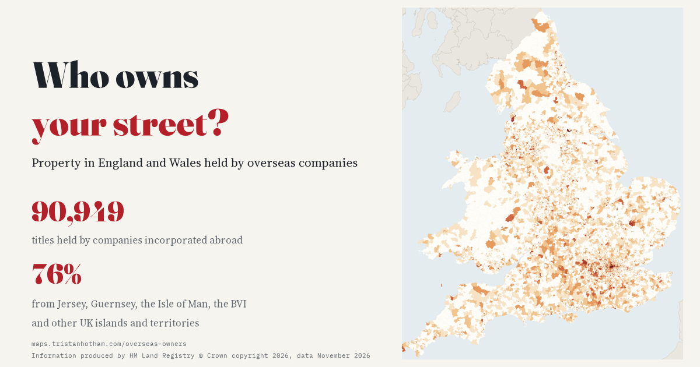

# Who owns your street?

**Property in England and Wales held by overseas companies, mapped for every small area.**

Dr Tristan Hotham · Independent researcher · 2026

- Interactive map: https://maps.tristanhotham.com/overseas-owners/
- Paper (Zenodo): https://doi.org/10.5281/zenodo.24115198
- Blog post: https://blog.tristanhotham.com/2026/10/31/overseas-owners/
- Code and data: https://github.com/Tristan-Hotham/overseas-owners

Information produced by HM Land Registry © Crown copyright 2026. Overseas companies that own property in England and Wales, data at November 2026.
Used under HM Land Registry's licence for non-commercial use. This repository contains **aggregate counts only**: no title
number, property address, postcode, proprietor address or row-level record from the dataset.



## Headline results

- 90,949 titles in England and Wales are held by companies incorporated overseas: 3.34 per 1,000 homes.
- Westminster (72.7 per 1,000) and Kensington and Chelsea (55.0) hold 16.0% of all titles with 0.81% of homes. The City of London has the highest rate (175). Outside London the highest is Salford (10.1).
- Titles are far more concentrated than homes: Gini 0.87 across 35,672 LSOAs against 0.14 for dwellings; half of all geocoded titles are in 744 LSOAs (2.1%). Yet 39.4% of LSOAs have at least one.
- 75.7% of titles are held by companies from the Crown Dependencies and British Overseas Territories: Jersey 26.8%, British Virgin Islands 20.5%, Guernsey 13.4%, Isle of Man 10.6%.
- Within districts (PPML, district fixed effects, N = 35,672 LSOAs, 318 clusters), per 10 percentage points: top Council Tax bands rate ratio 1.293 (95% CI 1.226 to 1.363); flats 1.298 (1.272 to 1.325); built since 2009 1.098 (1.060 to 1.136). All 18 planned checks keep every interval above 1; the within-district placebo centres on 1.00.

Overseas ownership of property is legal. The register records legal owners, not beneficial owners, uses or motives.

## Files

| Path | What |
|---|---|
| `index.html`, `js/page.js` | Interactive map (MapLibre, OpenFreeMap Positron): LSOA rates with a jurisdiction filter, district view, search by place or postcode (postcodes.io) |
| `data/results.json` | Every number quoted anywhere |
| `data/lsoa_counts.csv` | Per LSOA 2021: dwellings, titles (all, UK-linked, Jersey, BVI, Guernsey, Isle of Man, other), rate, housing shares |
| `data/lad_counts.csv`, `data/region_counts.csv` | Per district and region: titles (including those without a postcode), rate, rank, UK-linked share, most common jurisdiction, median price where at least 10 titles have one |
| `data/jurisdictions.csv`, `data/years.csv`, `data/prices.csv`, `data/holders.csv` | Titles by jurisdiction (with FSI 2018 score), by year owner added, price summaries, ten largest holders |
| `data/models.csv` | All model estimates |
| `data/lsoa_voa.csv`, `data/lsoa_lookup.csv`, `data/lad_names.csv` | VOA dwellings and housing shares by LSOA; LSOA to district lookup (OGL) |
| `data/lsoa.topo.json`, `data/lsoa_codes.json`, `data/lad.geojson`, `data/site*.json` | Page data |
| `release/paper/` | Paper (PDF, LaTeX, figures), cover note |
| `release/blog/` | Blog post (WordPress blocks), figures, meta |
| `release/zenodo/` | Paper PDF, data and code zip, metadata |
| `reddit/` | Collage, `collage.py`, GIF, `post.md` |
| `NOTES.md` | Analysis plan (written before any counts) and log |

## Method

Titles are placed in LSOAs by postcode (66,913, 73.6%); the other 24,036 enter district totals through the file's district field. Denominator: dwellings on the Council Tax list, 31 March 2025 (VOA CTSOP4.1). Jurisdictions are cleaned from free text; UK-linked offshore = Crown Dependencies and British Overseas Territories (fixed in advance). The within-district model is Poisson pseudo-maximum likelihood with district fixed effects, an offset for log dwellings and standard errors clustered by district. Robustness: negative binomial, leave one region out, without Westminster and Kensington and Chelsea, single-address, residential-looking, leasehold and freehold titles, suppressed VOA cells as 2.5, region fixed effects, and a 200-draw within-district placebo. The analysis was pre-specified in a written plan (NOTES.md).

## Sources and licences

- Information produced by HM Land Registry © Crown copyright 2026. HM Land Registry, Overseas companies that own property in England and Wales, full file, November 2026. Non-commercial licence; aggregates only.
- Valuation Office Agency (2025) Council Tax: stock of properties, tables CTSOP3.1 and CTSOP4.1. Open Government Licence v3.0.
- ONS LSOA 2021 and LAD 2023 boundaries (OGL v3.0; contains OS data © Crown copyright and database right), LSOAs via github.com/drkane/geo-lookups. postcodes.io (ONS Postcode Directory, OGL v3.0).
- Tax Justice Network, Financial Secrecy Index 2018 secrecy scores, via github.com/Global-Witness/secret-property-analysis-2019-public.
- Wikidata (CC0) for search places; OpenFreeMap / OpenStreetMap (ODbL) base map.
- Licences: code MIT; text CC BY 4.0; figures and derived data non-commercial (CC BY-NC 4.0 and HM Land Registry's terms). See LICENSE.

## Rerun

The HM Land Registry file is not included; obtain it from HM Land Registry (https://use-land-property-data.service.gov.uk/) under its licence and set `OO_RAW`.

```
cd code
python3 00_lookup.py && python3 01_prepare.py && OO_DASH=2.5 python3 01_prepare.py
python3 02_analysis.py && python3 02b_exploratory.py && python3 03_results.py
python3 04_figures.py && python3 05_site_data.py && python3 06_site.py
python3 07_paper.py        # DOI=10.5281/zenodo.N python3 07_paper.py to fill the DOI
python3 08_header.py && python3 ../reddit/collage.py && python3 10_readme.py && python3 09_release.py
```

## Cite

Hotham, T. (2026) Who owns your street? The small-area geography of property in England and Wales held by overseas companies. Zenodo. https://doi.org/10.5281/zenodo.24115198

I wrote the text, with drafting and editing assistance from Claude (Anthropic), which also helped prepare the analysis code. I reviewed and checked all text and results.
